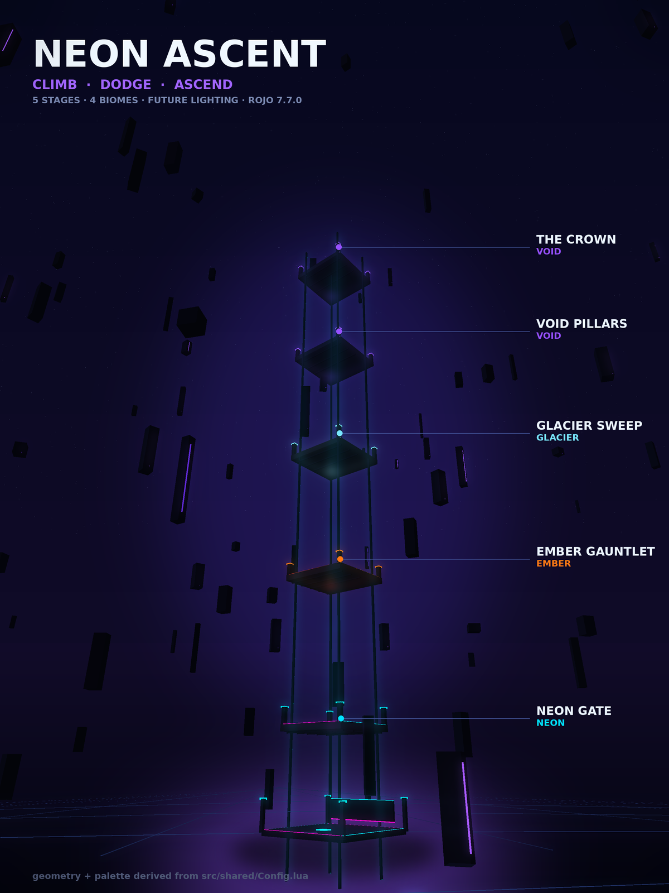

# 🌆 Neon Ascent

A vertical tower-climb game for Roblox. Five stages stack upward through four
colour-coded biomes — race the hazards, bank the checkpoints, take the crown.

Built on Linux against the [Rojo](https://github.com/rojo-rbx/rojo) toolchain,
entirely with open-source tooling from GitHub.



> **About that image:** it is a *previsualisation*, not a screenshot. It is
> rendered by `docs/render3d.py` using the exact same tower geometry and biome
> colours as the game (`src/shared/Config.lua` / `src/server/World.lua`), so it
> shows the real layout and palette — but the game itself has not been captured
> running. See [Status](#status) below. Honesty over hype.

---

## Quick start — play it in 60 seconds

You do **not** need the Rojo toolchain to play. The built place file is
committed.

1. **Install Roblox Studio** (free): <https://create.roblox.com/landing/studio>
2. **Clone or download** this repo:
   ```bash
   git clone https://github.com/areli703/neon-ascent.git
   ```
   …or hit the green **Code ▸ Download ZIP** button and extract it.
3. **Double-click** `build/NeonAscent.rbxl` — or in Studio, *File ▸ Open from
   File* and pick it.
4. Press **▶ Play** (or **F5**). You spawn in the lobby at the tower base.

That's it. No plugins, no packages, no setup.

> `.rbxl` is Roblox's binary place format — the standard "double-click and it
> opens in Studio" file. `build.sh` regenerates it from source.

### Controls

Standard Roblox defaults — nothing custom to learn:

| Input | Action |
|-------|--------|
| `W` `A` `S` `D` | Move |
| `Space` | Jump |
| Mouse | Look / orbit camera |
| `Shift` | Sprint (if enabled) |

Climb the tower. Reach a stage platform to bank a checkpoint. Hazards are
**lethal only while a round is Climbing** — during Intermission you can roam the
tower freely and look around.

---

## The game

### Round loop

```
Intermission  →  Countdown  →  Climbing  →  Results
 free roam       5..1, players    hazards      standings,
 tower disarmed  at checkpoints   live         then repeat
```

### The tower — 5 stages, 4 biomes

| # | Stage | Biome | Palette |
|---|-------|-------|---------|
| 1 | **Gate** | Neon | magenta / cyan |
| 2 | **Gauntlet** | Ember | orange / amber |
| 3 | **Sweep** | Glacier | ice blue / white |
| 4 | **Pillars** | Void | violet / deep purple |
| 5 | **The Crown** | Void | violet / gold |

Each stage is a 96-unit platform, spaced 190 units apart vertically, with four
corner towers. The biome declares itself in `Config.Stages[i].Biome` — reorder
or add a stage and the world, lighting and palette follow automatically.

### Systems

- **Hazard engine** — spiral bars, sweeping gauntlets, rotating arms,
  sine-driven rising pillars. All advanced by a *single* server `Heartbeat`
  through a step-function registry, rather than hundreds of individual
  connections.
- **Per-biome lighting** — `Future` technology, volumetric atmosphere, bloom
  thresholded so only genuinely bright neon blooms. The whole sky crossfades as
  you climb.
- **Server-authoritative checkpoints** — position-based, not `Touched`, so
  progress can't be spoofed by a modified client.
- **In-world leaderboard** — a physical glass slab in the lobby, rebuilt from
  live ranking.
- **Client-side VFX** — camera shake, hit flash, checkpoint rings, confetti.
  Runs locally, so one player's celebration costs nobody else frames.

### Architecture

```
src/
├── shared/          # runs on both sides
│   ├── Config.lua       single source of truth: tower geometry, stages, biomes
│   ├── Remotes.lua      typed remote factory
│   └── Util.lua         shared helpers
├── server/
│   ├── init.server.lua  bootstrap: remotes → world → obstacles → systems
│   ├── World.lua        tower construction from Config
│   ├── Obstacles.lua    hazard build + single-Heartbeat stepping
│   ├── GameMode.lua     round loop, checkpoint detection, scoring
│   ├── PlayerService.lua  spawn/respawn invariants
│   ├── Leaderboard.lua  in-world ranking slab
│   ├── Lighting.lua     atmosphere rigs
│   └── Effects.lua      server → client effect broadcasts
└── client/
    ├── init.client.lua  pure wiring: remotes in → HUD/effects out
    ├── HUD.lua          slim banner + progress panel
    └── EffectsClient.lua  camera shake, flashes, lighting crossfade
```

Two invariants worth knowing:

- **The server never touches UI; the client never decides game logic.**
- **PlayerService never respawns you past your progress, and never inside a
  hazard.**

---

## Building from source

Only needed if you want to modify the game.

```bash
# 1. Install the pinned toolchain (Rojo 7.7.0, Selene, StyLua, Lune, Wally)
#    https://github.com/rojo-rbx/rokit
rokit install

# 2. Build the place file
./build.sh                    # → build/NeonAscent.rbxl
#    or: rojo build default.project.json -o build/NeonAscent.rbxl

# 3. Lint + format
stylua src/
selene src/
```

`rokit.toml` pins exact versions, so a clone builds identically on Windows, macOS
and Linux.

### Live-sync workflow (optional)

With Studio open, serve the source tree so edits hot-reload into the running
game instead of rebuilding the `.rbxl` each time:

```bash
rojo serve
```

Then in Studio, connect via the **Rojo** plugin.

---

## Status

Written honestly, because a README that overclaims is worse than no README.

**Verified**

- ✅ Builds clean: `rojo build` produces a valid `.rbxl`; all 14 scripts are
  embedded with their full source (verified by unpacking the binary, not by
  trusting the exit code).
- ✅ Lint and format gates green: `selene` reports 0 errors and 0 warnings;
  `stylua --check` passes.
- ✅ Architecture is sound — see the invariants above.
- ✅ A load-time assert in `Config.lua` fails loudly if
  `CheckpointsToQualify` ever exceeds the number of stages.

**Not verified — read this**

- ❌ **The game has never been executed.** Roblox Studio has no native Linux
  build, and this was developed on Linux, so nothing here is play-tested.
- ❌ **No performance data.** Frame time has not been measured. No numbers are
  claimed.
- ❌ **The render above is a previsualisation**, generated from the game's own
  geometry values — not a capture of the running game.

Static analysis proves the code parses and type-checks. It does **not** prove the
tower is fun, that hazard timing feels fair, or that the round loop is stable
across many rounds. Those need a human in Studio. If you find something broken,
that's expected surface area, not a surprise.

---

## License

MIT — see [LICENSE](LICENSE).
